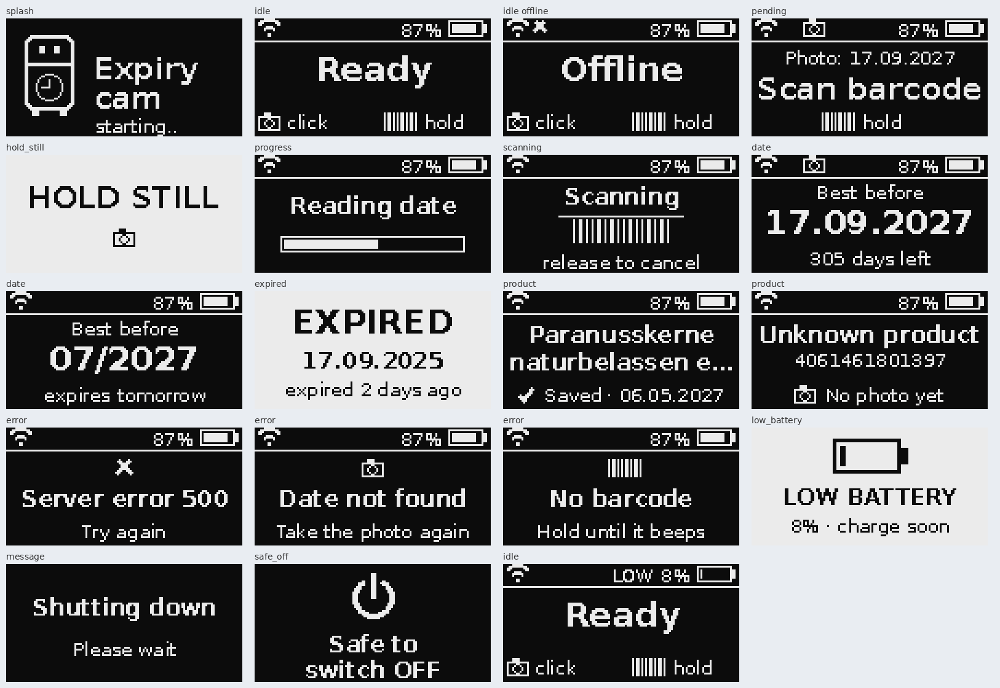

# Expiry cam

A handheld expiry date scanner: it photographs the date on a package, reads the product
barcode and sends both to a home server. The server reads the date (OCR), looks up the
product name and keeps the list, and a Telegram bot reminds you what is about to expire.

```
┌──────────── Scanner (Pi 3A+) ───────────┐        Wi-Fi        ┌──────────── Main station (Pi 5) ──────────────┐
│ trigger click → photo (Camera Module 3) │  POST /image (JPEG) │ server.py  OCR (PaddleOCR) → date             │
│ trigger hold  → barcode (GM67)          │ ──────────────────► │            Open Food Facts → product name     │
│ 1.3" OLED — results and hints           │  POST /barcode      │ expirycam.db (SQLite)                         │
│ 2S battery + ADS1115 — charge level     │ ◄────────────────── │ bot.py     Telegram: reminders, /list, delete │
└─────────────────────────────────────────┘   date / product    └───────────────────────────────────────────────┘
```

| | Scanner | Main station |
|---|---|---|
| Board | Raspberry Pi 3A+ (512 MB) | Raspberry Pi 5 (8 GB) |
| Hostname | `my-beautiful-scanner` | `my-beautiful-RPi` |
| User | `rasient` | `rasient` |
| Project folder | `~/expiry_cam` | `~/expiry_cam` |
| Python venv | `~/expiry_cam/venv` (with system site packages) | `~/expiry_cam/.venv` |
| Services | `expiry-cam` | `expiry-server`, `expiry-bot` |

### Repository

```
expiry_cam/
  README.md, LICENSE, .gitignore
  deploy.sh            copies one part of the project to its Pi and restarts its services
  scanner/             → ~/expiry_cam on the scanner
    app.py             main program
    config.py          settings (values of this particular scanner)
    oled_safe.py       last screen at power off (for the shutdown hook)
    hw/                hardware: battery, camera, gm67 (protocol), barcode (reading codes)
    ui/                screen: display (OLED thread), screens (drawing)
    net/               client (talking to the server)
    tools/             gm67_setup, calibrate, oled_test, i2c_test.sh
    system/            systemd service, shutdown hook, install.sh
  server/              → ~/expiry_cam on the Pi 5
    server.py          HTTP API (uvicorn server:app)
    bot.py             Telegram bot
    core/              db, dates, products (Open Food Facts)
    ocr/               engine (PaddleOCR pipeline), parser (date in text)
    system/            systemd services, install.sh
    bot.env.example, requirements.txt
  ocr_research/        → ~/expiry_cam/ocr_research on the Pi 5: dataset tools, benchmark
  hardware/            parts list, KiCad schematic
  docs/                images: OLED screens, bot avatar
```

Code is edited on the PC and gets to the devices with `deploy.sh` (section 9).

---

## Contents

1. [Usage](#1-usage)
2. [Scanner hardware](#2-scanner-hardware)
3. [Raspberry Pi OS setup on the scanner](#3-raspberry-pi-os-setup-on-the-scanner)
4. [Scanner software](#4-scanner-software)
5. [GM67 barcode module](#5-gm67-barcode-module)
6. [Battery and calibration](#6-battery-and-calibration)
7. [Main station: server](#7-main-station-server)
8. [Telegram bot](#8-telegram-bot)
9. [Cheat sheet: deploy, restart, logs](#9-cheat-sheet-deploy-restart-logs)
10. [Troubleshooting: what broke and how it was fixed](#10-troubleshooting-what-broke-and-how-it-was-fixed)
11. [Open tasks](#11-open-tasks)

---

## 1. Usage

**Rocker switch** (ON-OFF-ON): `CHARGE` — charging (Pi is off), `OFF`, `RUN` — operation.
The battery can only be charged in the `CHARGE` position.

**Buttons**

| Action | What happens |
|---|---|
| Trigger, short press | Photo of the date → the server reads it → the screen shows the date and the days left |
| Trigger, hold (> 0.4 s) | GM67 scans while the trigger is held; the barcode is linked to the last photo |
| Power, hold 3 s | Shutdown → "Safe to switch OFF" → the rocker can be set to `OFF` |
| Power, double press | Reboot |

**Workflow:** first the photo of the date, then the barcode of the same product.
- The photo is only a **draft**: it is not in the bot's list and gets no reminders.
- Wrong date on the screen → just take the photo again. The new photo replaces the draft,
  the wrong one is never saved.
- The right date → scan the barcode: only now the product is saved ("Saved").
- The draft waits 3 minutes for its barcode ("Scan barcode" on the screen, camera icon in the
  status bar), then it is dropped.
- No date found ("Date not found", then "No date · retake or scan code" for 3 minutes):
  take the photo again. If the date is unreadable no matter what, scan the barcode instead:
  the product is saved **without a date** and the date is typed in the bot.
- Only the last photo counts: date → no date → barcode saves the product without a date.
- A barcode without any photo only shows the product name, nothing is saved.

**Screen** (all screens are in `ui/screens.py`):



- status bar: server connection (Wi-Fi icon, a cross = server not reachable),
  camera icon = a photo waits for its barcode, battery level;
- "HOLD STILL" on a white background — the photo is being taken, hold steady; as soon as it changes
  you can move;
- "EXPIRED" on a white background — the date on the photo is already over;
- "Already in list · now ×2" (white bar under the product) — the same product with the same
  date was scanned before. It is stored anyway (it may be a second unit); a re-scan by mistake
  is removed in the bot ("Delete 1");
- "Saved · no date" or "Unknown product" with a white "Fix in Telegram" bar — saved, but the
  date or the name is missing: it waits in the bot's "❓ Needs info" group (the bot sends
  no message about it by itself);
- after 1 minute without a button press the screen dims, after 5 minutes it turns off (OLED burn-in
  protection); any press wakes it up and performs its action right away.

**Telegram bot:** every day at 9:00 it reminds about products that expire within the next 3 days
(once per product). Expired products are removed automatically after midnight.
Commands: `/list` (the "✏️ Edit…" button under the list: date, name, delete), `/soon`, `/lang`,
`/stop`, `/start`, `/help`.

---

## 2. Scanner hardware

### Components

| Component | Details |
|---|---|
| Raspberry Pi 3A+ | powered via micro-USB (plug with screw terminals) |
| Camera Module 3 (imx708) | CSI, autofocus; mounted **upside down** (see `--rotation 180`) |
| GM67 | barcode module, E470 engine, firmware 3.0.21, UART TTL 9600 baud |
| 1.3" OLED SH1106 | I²C, address `0x3C` |
| ADS1115 | ADC for the battery voltage, I²C, address `0x48`; **SDA/SCL pull-up resistors removed from the board** |
| Voltage divider | 100 kΩ / 47 kΩ to input A0 + 100 nF capacitor (A0 → GND) |
| Battery | Keeppower 2S1P 18650, 3400 mAh, with built-in protection (BMS) |
| Charger | Hailege 2S USB-C (2 A version) |
| Buck converter | Mini560 PRO, 5 V output |
| Rocker switch | ON-OFF-ON: CHARGE / OFF / RUN |

### Power

```
           ┌── CHARGE ──► charger board (USB-C) ◄─► battery
battery    ┤
 2S, BMS   └── RUN ─────► Mini560 (5 V) ──► micro-USB ──► Pi 3A+
                 │
                 └── divider 100k/47k ──► ADS1115 A0   (voltage measurement)
```

- Full battery: about 8.2–8.4 V; warning below 7.0 V; shutdown below 6.6 V.
- Charging current measured with a USB tester: about 0.58 A at 5.2 V.

### Connections to the Pi (BCM numbering, physical pin)

| Signal | GPIO | Pin | Goes to |
|---|---|---|---|
| Power button | GPIO23 | 16 | button → GND (internal pull-up) |
| Trigger | GPIO24 | 18 | button → GND (internal pull-up) |
| I²C SDA | GPIO2 | 3 | OLED + ADS1115 |
| I²C SCL | GPIO3 | 5 | OLED + ADS1115 |
| UART TX | GPIO14 | 8 | → GM67 RX |
| UART RX | GPIO15 | 10 | ← GM67 TX |
| 3.3 V / GND | | 1, 17 / 6, 9, … | power for OLED and ADS1115 |

Power for the GM67 and the camera: see the KiCad schematic.

### Wiring lessons

- **Solder I²C, do not build it with thin wires in WAGO clamps.** Thin AWG28 wires in WAGO clamps
  caused `Errno 5` errors on the display. Fix: power and ground of the OLED/ADS go directly to the Pi,
  SDA/SCL are soldered together at one point. Zero errors since then.
- There must be **one** set of pull-ups on the bus. The pull-ups on the ADS1115 board (10 kΩ) were
  removed; the OLED/Pi pull-ups remain (about 1.64 kΩ in total).
- Faston crimp terminals on the rocker: a bad crimp caused "no voltage at the buck converter input".
  Find it with a continuity test along the circuit from the battery.
- The buttons' ground still goes through a WAGO clamp — it works, but soldering is more reliable.

---

## 3. Raspberry Pi OS setup on the scanner

### `/boot/firmware/config.txt` (in the `[all]` section)

```ini
dtparam=i2c_arm=on
enable_uart=1
dtoverlay=disable-bt
```

- `disable-bt` gives the full UART (`/dev/serial0` → `ttyAMA0`) to the GM67.
- The `gpio-shutdown` overlay is **not needed** — `app.py` handles the power button.
- Better remove the `dtparam=i2c_arm_baudrate=…` line (a lower bus speed did not help, the cause was
  the wiring).

### `/boot/firmware/cmdline.txt`

Remove `console=serial0,115200`, otherwise a login console (`agetty`) runs on the UART and
disturbs the GM67 — this was the main reason why the module "did not answer":

```bash
sudo sed -i 's/console=serial0,115200 //' /boot/firmware/cmdline.txt
sudo systemctl disable --now serial-getty@ttyAMA0.service
sudo systemctl mask serial-getty@ttyAMA0.service
```

### Packages and environment

Approximate list (what is really installed in the venv: `venv/bin/pip list`):

```bash
sudo apt install python3-venv python3-requests python3-serial python3-smbus \
                 python3-gpiozero python3-pil fonts-dejavu-core i2c-tools rsync
cd ~/expiry_cam
python3 -m venv --system-site-packages venv
venv/bin/pip install luma.oled
```

Check: `/usr/sbin/i2cdetect -y 1` must show `3c` and `48`
(`/usr/sbin` may not be in `PATH` in some terminals, hence the full path).

### Service, shutdown hook, sudo rule: `system/install.sh`

Once, after the first deploy (on the scanner, from `~/expiry_cam`):

```bash
sudo system/install.sh
```

The script installs:
- the `expiry-cam` service (`system/expiry-cam.service`): runs as root — it needs access to GPIO,
  UART, I²C and `systemctl poweroff`; `Restart=always`;
- the "Safe to switch OFF" hook (`system/oled-safe` → `/usr/lib/systemd/system-shutdown/`).
  systemd runs the files in this folder at the very last moment, when all services are stopped and
  the file system is read-only; the first argument is `poweroff` / `reboot` / …;
- a sudo rule (`/etc/sudoers.d/expiry-cam`): `systemctl restart|stop|start expiry-cam` without a
  password, so `deploy.sh` can restart the service. Every other `sudo` still asks for the password.

Test the hook without shutting down: `sudo /usr/lib/systemd/system-shutdown/oled-safe poweroff`.

### Editing code

Code is edited on the PC (VS Code, Claude Code) and copied to the device with `deploy.sh` (section 9).
VS Code Remote-SSH does not work on the Pi 3A+: the VS Code server needs more than 1 GB of RAM
(it ran out of memory).

---

## 4. Scanner software

### Files (`scanner/` in the repo = `~/expiry_cam` on the scanner)

| File | What it does |
|---|---|
| `app.py` | main program: buttons, states, background jobs, screens |
| `config.py` | settings |
| `oled_safe.py` | last screen at power off (called by the hook) |
| `hw/battery.py` | battery thread: ADS1115 reading, percent, automatic shutdown |
| `hw/camera.py` | photo with `rpicam-still` |
| `hw/gm67.py` | GM67 protocol: packets, commands, list of settings |
| `hw/barcode.py` | thread reading the GM67 over UART, START/STOP scanning (`BarcodeReader`) |
| `ui/display.py` | owns the OLED: own thread, animations, dimming/turning off, reconnecting |
| `ui/screens.py` | all screens (PIL only, no luma) — also used by `oled_safe.py` |
| `net/client.py` | HTTP to the server, connection check every 10 s |
| `tools/gm67_setup.py` | one-time GM67 configuration (section 5) |
| `tools/calibrate.py` | battery measurement calibration with a multimeter |
| `tools/oled_test.py` | display check (frame and text) |
| `tools/i2c_test.sh` | 300 transfers to one I²C device, counts errors |
| `system/` | service, shutdown hook, `install.sh` |

Tools run from `~/expiry_cam` as modules: `venv/bin/python -m tools.<name>`.

### How `app.py` works

- Button callbacks and threads only put events into a queue; the main loop does all the work.
- States: `SPLASH` (start screen) → `IDLE` → `BUSY` (photo/request in the background) / `SCANNING`
  (trigger held) → `RESULT` (result for 5 s) → `IDLE`.
- Slow actions (photo, upload) run in a separate thread; the result comes back as an `EV_JOB_DONE`
  event together with what to do with the photo that waits for its barcode.
- A photo without a date waits too (`no_date=True`): a barcode within 3 minutes is sent with
  `"no_date": true` and the server saves the product without a date.
- The power button is handled directly in its callback, so it works in every state.
- Shutdown: the "Shutting down" screen is drawn and **only then** `systemctl poweroff` is called
  (in `finally`, so even a display error cannot block the shutdown).

### Camera (`hw/camera.py`)

```
rpicam-still --nopreview --timeout 1000 --autofocus-on-capture --autofocus-range macro
             --autofocus-speed fast --autofocus-window 0.25,0.25,0.5,0.5 --mode 2304:1296
             --width 2304 --height 1296 --rotation 180 --sharpness 1.2 --quality 93
             --denoise cdn_off -o <file>
```

- Measured: before 3.2 s and 1.9 MB (`--timeout 2500`, `--quality 100`), now 2.3 s and 640 KB,
  same quality.
- `--autofocus-on-capture`: one autofocus cycle right before the shot.
- `--rotation 180`: the camera is mounted upside down.
- OCR downsizes the photo to 1000 px anyway, so 2304×1296 is more than enough.
- Not tested yet: low light. If photos are dark, raise `--timeout` to 1500.

### Server connection (`net/client.py`)

- `POST /image`: timeouts 5 s to connect, 45 s for the answer; `POST /barcode`: 5 / 15 s.
- A new connection for every request (no keep-alive), so there are no stale connections.
- `GET /health` every 10 s; "offline" after two failures in a row (confirmed after 2 s), or right
  away when a real request fails. When the server is back, the icon changes within 5 s.
- After a successful upload the photo is deleted from the scanner (`KEEP_LOCAL_PHOTOS = True` keeps
  it); after an error it stays in `captures/`.

### Screen (`ui/display.py` + `ui/screens.py`)

- Only the display thread touches the I²C device; other threads only change the state.
- Animations (progress bar, scanner laser, start screen) run at about 5 frames/s.
  A full frame over I²C at 100 kHz takes about 0.1 s.
- The progress bar adapts to the real recognition time and never reaches the end before the answer.
- Constants at the top of `ui/display.py`: `DIM_AFTER_S = 60`, `OFF_AFTER_S = 300`, brightness.
- Constants at the top of `app.py`: barcode wait `PENDING_TIMEOUT_S = 180`, start screen and
  message durations.
- If the display is lost (I²C error), the thread reconnects every 5 s.

### `config.py` reference

| Setting | Value | Meaning |
|---|---|---|
| `PIN_POWER`, `PIN_TRIGGER` | 23, 24 | buttons |
| `POWER_HOLD_S` / `POWER_DOUBLE_S` / `TRIGGER_HOLD_S` | 3.0 / 0.6 / 0.4 | button timing |
| `OLED_ADDR`, `OLED_DRIVER` | `0x3C`, `sh1106` | display |
| `ADS_ADDR`, `K_DIV` | `0x48`, 147/47 | ADC and divider |
| `K_CAL` | **1.0055 on this device** | calibration (section 6) |
| `BATTERY_WARN_V` / `BATTERY_CUTOFF_V` | 7.0 / 6.6 V | warning / shutdown (if below for 30 s) |
| `BATTERY_SHOW` | `True` | always show the battery level (`False` = only when low) |
| `SCANNER_PORT`, `SCANNER_BAUD` | `/dev/serial0`, 9600 | GM67 |
| `SCANNER_WAKE_BYTE` | **`True` on this device** | wake the GM67 with a `0x00` byte before a command |
| `RESULT_SHOW_S` | 5 | how long a result stays on the screen |
| `SERVER_URL` | `http://my-beautiful-RPi.local:8000` | server |
| `KEEP_LOCAL_PHOTOS` | `False` | keep photos on the scanner after upload |
| `SERVER_CHECK_S` | 10 | how often the connection is checked |

---

## 5. GM67 barcode module

### How it is used

**Host** mode: the module only scans on command. Trigger held → the Pi sends `START_DECODE`,
released → `STOP_DECODE`. The barcode arrives as text ending with `CR LF`.

### Protocol (manual, Appendix 6)

Packet: `length, opcode, source 0x04, status, data…, checksum (2 bytes)`,
checksum = `0x10000 − sum of bytes`, high byte first.
Writing a parameter: opcode `0xC6`, status `0x08` (store permanently). The module answers ACK/NAK.

Quirks of this unit (E470, FW 3.0.21):
- it **falls asleep** — a `0x00` byte and a pause of ≥ 10 ms are needed before a command
  (`SCANNER_WAKE_BYTE = True`);
- the "quick set" command for the scan time, `F2 FA`, **hangs the module** — use parameter `0x88`
  instead (in 0.1 s units).

### Settings (`hw/gm67.py`, `SETTINGS`, 19 of them)

host mode (`8A 08`) · CR LF terminator · no delay for reading the same code again ·
1D on, 2D off (otherwise a QR code on the package is read instead of the EAN) · EAN-13/8, UPC-A/E on ·
send the check digit and the UPC leading digit · no beep at power-up, beep on success,
medium volume · at most 10 s of scanning per START.

### `tools/gm67_setup.py`

```bash
sudo systemctl stop expiry-cam              # free the serial port
cd ~/expiry_cam
sudo venv/bin/python -m tools.gm67_setup --diag   # how the module wakes up (safe)
sudo venv/bin/python -m tools.gm67_setup --wake   # write the settings
sudo venv/bin/python -m tools.gm67_setup --test --wake   # START, read one code, STOP
sudo venv/bin/python -m tools.gm67_setup --lock --wake   # + ignore setup barcodes
sudo venv/bin/python -m tools.gm67_setup --factory-reset
sudo systemctl start expiry-cam
```

The script refuses to run if the port is used by the service or another process.
It pauses 1 s between commands and stops after two failures in a row.

If the module does not answer at all or sends garbage: scan the QR codes **"TTL 232"** (the module
may be in USB mode) and **"9600bps"** from the manual.

---

## 6. Battery and calibration

- `hw/battery.py` reads A0 every 5 s (raw ADS1115 request, config `0xC383`, ±4.096 V),
  takes the median over 30 s and converts it to percent with `SOC_TABLE`.
- Below 7.0 V: a full-screen "LOW BATTERY" once, then "LOW" in the status bar.
- Below 6.6 V for 30 s in a row: automatic shutdown.
- `SOC_TABLE` is **approximate**; refine it with a discharge test (section 11).

### Calibration (`tools/calibrate.py`)

1. The scanner app is running (same load as in real use).
2. Multimeter on `BUCK IN+` / `IN−`.
3. `venv/bin/python -m tools.calibrate` — about 10 seconds of measurements, then enter the
   multimeter reading.
4. The script prints `K_CAL` → put it into `config.py` (this device: **1.0055**).

---

## 7. Main station: server

### Files (`server/` in the repo = `~/expiry_cam` on the Pi 5)

| File | What it does |
|---|---|
| `server.py` | HTTP API (Starlette + uvicorn), OCR in one dedicated thread |
| `bot.py` | Telegram bot (section 8) |
| `core/db.py` | SQLite: scans, product cache, bot chats; migrates old tables by itself |
| `core/dates.py` | parser strings → real dates, display format |
| `core/products.py` | barcode → product name: cache first, then Open Food Facts |
| `ocr/engine.py` | OCR pipeline (PaddleOCR, 2.x API, language german) |
| `ocr/parser.py` | finds the date in the OCR text |
| `system/` | `expiry-server.service`, `expiry-bot.service`, `install.sh` |
| `bot.env.example` | bot settings template |
| `requirements.txt` | Python packages (PaddleOCR stack + `starlette uvicorn python-multipart requests`) |

The database (`expirycam.db`), photos (`uploads/`) and `bot.env` live in `~/expiry_cam` on the Pi 5
only. The OCR dataset and benchmark are in [`ocr_research/`](ocr_research/README.md)
(best result 70/100, median 3.4 s).

### API

```
GET  /health               {"status": "ok", "ocr_ready": true}
POST /image   (file=JPEG)  {"scan_id", "expiry", "expiry_display", "expires_on", "days_left",
                            "expired", "raw_text", "ocr_seconds"}
                           date found → stored as a draft (scan_id), a product only after /barcode;
                           every new photo drops the waiting draft (photo → uploads/rejected/);
                           no date found → scan_id = null, nothing is stored in the database,
                           the photo is kept in uploads/failed/ (for OCR tuning)
POST /barcode (JSON)       {"barcode": "4000417025005", "scan_id": 12 | null, "no_date": false}
                           scan_id = the draft → it becomes a product;
                           no_date = true (the last photo found no date) → a product without a date;
                           neither → lookup only, nothing is stored
                           → {"barcode", "product", "brand", "quantity", "scan_id", "expiry_display",
                              "count", "saved"}   count = units with this barcode and date in the list
GET  /scans?limit=20       latest records
```

Manual check:
```bash
curl http://localhost:8000/health
curl -F file=@<photo>.jpg http://localhost:8000/image     # creates a draft (and drops the scanner's!)
curl "http://localhost:8000/scans?limit=5"
```

### How it works

- **OCR** (PaddleOCR) is not thread-safe and keeps per-thread caches, so model loading, warm-up and
  every recognition run in **one** long-lived thread; photos are processed one after another.
  The model is loaded when the service starts. Uvicorn runs a single process (each process would
  load its own copy of the model).
- **Dates** (`dates.py`): the parser returns `DD-MM-YYYY`, `00-MM-YYYY` (month and year only) or
  `DD-MM-0000` (no year).
  - Month and year only → **last day of the month** (01/2027 = 31.01.2027, leap years included).
  - No year → the next such date from the scan day on.
  - The database stores the resolved date `expires_on`; it is displayed as printed on the package.
- **Products** (`products.py`): the barcode is normalized (12-digit UPC-A → 13-digit EAN), then the
  `products` cache table is checked, then the Open Food Facts API v2. Unknown codes are re-checked
  once a week, network errors are not cached. A name typed in the bot (`custom_name`) always wins
  and is used for the next scans of that barcode. Products saved without a name (unknown, or the
  network was down) are looked up again every night by the bot. User-Agent `ExpiryCam/0.1 (hobby project)`, can be
  changed with the `EXPIRYCAM_USER_AGENT` variable.
- Open Food Facts has no medicines; food supplements (being food) are sometimes there.

### Database `expirycam.db`

- Table `scans`: `id, created_at (UTC), raw_text, parsed_expiry_date, expires_on, status,
  barcode, product_name, product_brand, image_path, source, ocr_seconds, notified, draft`.
  Products are the rows with `source = 'scanner'` and `draft = 0`; `draft = 1` is a photo that
  still waits for its barcode. Benchmark rows (`source = 'benchmark'`) are never touched by the
  bot or the cleanup.
- Products may have no date (`expires_on` is empty: saved after a failed photo) or no name
  (`product_name` is empty): both can be set in the bot.
- `products` — Open Food Facts cache plus `custom_name` (the name typed in the bot);
  `bot_chats` — subscribers and language; `bot_state` — when the last cleanup and reminder ran.
- WAL mode: the server and the bot use the database at the same time.
- The path can be changed with the `EXPIRYCAM_DB` variable.
- Photos: `uploads/YYYY-MM-DD/`, deleted together with their product; failed ones (no date) in
  `uploads/failed/`; photos of drafts that never got a barcode (usually a wrongly read date that
  was taken again) in `uploads/rejected/`.

### Installation

After the first `./deploy.sh server`, on the Pi 5:

```bash
cd ~/expiry_cam
source .venv/bin/activate
pip install -r requirements.txt
python -m uvicorn server:app --host 0.0.0.0 --port 8000     # test run, Ctrl+C
sudo system/install.sh        # services + sudo rule for deploy.sh (restart without password)
sudo systemctl restart expiry-server expiry-bot
```

The services run as the user `rasient`, so PaddleOCR finds the models it already downloaded into
the home folder. The Pi 5 time zone must be Europe/Berlin (`timedatectl`).

---

## 8. Telegram bot

### Features

- **Reminder** every day at `REMIND_TIME` (09:00): products that expire within the next
  `REMIND_DAYS` (3) days. With `REMIND_ONCE=1` each product is in one reminder only.
  If there is nothing to remind about, the bot stays silent. If the Pi 5 was off at 9:00, the
  reminder is sent when it starts. When a reminder is sent anyway and some products need info,
  it ends with one line "❓ Needs info: N — /list" (no separate messages).
- **Cleanup** after midnight: expired products are deleted together with their photos;
  drafts older than 1 hour (photo without barcode) are dropped, their photos go to `uploads/rejected/`.
  Products without a date are never deleted automatically. Then products without a name are
  looked up in Open Food Facts again.
- `/list` — everything scanned, in groups: ❓ needs info (no date or no name, always on top),
  🔴 within 3 days, 🟠 within 30 days, 🟡 within 3 months, 🟢 later. The date on the left
  (monospace, in a straight column, `??.??.??` = no date), the name without the brand on the
  right. The same product with the same date is one line with **×N** (each unit is still its
  own database row with its own photo); units without a date are never merged.
- The "✏️ Edit…" button under the list: products as buttons (8 per page, ❓ ones first) →
  product card: its name and date, "📅 Date", "🏷 Name", delete. For ×N the card offers
  "Delete duplicates (1 left)" — removes every unit except the first scanned one — and, from ×3
  on, also "Delete 1" (removes the last scanned unit). The list is updated in the same message.
- **📅 Date**: the bot asks for the date and the next message is the answer: `12.03.27`,
  `12.3.2027`, `2027-03-12`, `03/2027` (month and year = last day of the month), `12.03.`
  (next such day). A past date or something unreadable is asked again. The new date gets its
  own reminder. For ×N it changes every unit of the line. After a product without a date, the
  bot offers the same date for the other units of this product that have none.
- **🏷 Name** (up to 60 characters): the next message is the name. It goes to every unit with
  this barcode and is remembered: the next scan shows it on the scanner, Open Food Facts never
  overwrites it.
- The question waits 5 minutes; any command or "✖ Cancel" ends it earlier. In a group chat the
  answer has to be a reply to the bot's question (Telegram privacy mode).
- `/del_<id>` — delete by number (also works for links in old messages).
- `/soon` — what expires in the next days (all of them, not only new ones). Reminders and `/soon`
  also show ×N.
- `/lang` — Russian / English, per chat.
- `/stop` — no more reminders, `/start` — reminders again.

### Access

The bot only answers chats listed in `TELEGRAM_ALLOWED_IDS`. Everyone else gets "no access" together
with the ID of their chat. Private chat: the ID is the person's ID. Family group: the group's
(negative) ID.

### Setup

1. @BotFather → `/newbot` → token. **Never show the token to anyone.**
2. ```bash
   cd ~/expiry_cam
   cp bot.env.example bot.env && chmod 600 bot.env
   nano bot.env                  # TELEGRAM_TOKEN=...
   source .venv/bin/activate
   python bot.py                 # everyone sends /start to the bot and gets their ID
   ```
3. Ctrl+C, put the IDs (comma separated) into `TELEGRAM_ALLOWED_IDS`, start the service
   (installed by `system/install.sh`):
   ```bash
   sudo systemctl restart expiry-bot
   ```
4. Everyone sends `/start` once more — this subscribes them to the reminders.
5. Avatar: @BotFather → `/setuserpic` → [`docs/bot_avatar.png`](docs/bot_avatar.png).

### `bot.env`

| Variable | Default | Meaning |
|---|---|---|
| `TELEGRAM_TOKEN` | — | token from BotFather |
| `TELEGRAM_ALLOWED_IDS` | — | allowed chats, comma separated |
| `REMIND_TIME` | `09:00` | reminder time (Pi's local time) |
| `REMIND_DAYS` | `3` | how many days ahead to remind |
| `REMIND_ONCE` | `1` | `1` = once per product, `0` = every day until it expires |
| `TELEGRAM_FORCE_IPV4` | `0` | `1` = talk to Telegram over IPv4 only |

### Internals

The bot talks to the Telegram Bot API directly with `requests` (long polling — no open ports or
public IP needed) over one persistent connection. Open questions (date / name) are kept in
memory: after a restart the button is simply pressed again. The log shows how long each command took, slow
requests, and a warning if two copies are running. The token never ends up in the log.

---

## 9. Cheat sheet: deploy, restart, logs

### Deploy from the PC

Once on the PC: `rsync` (`sudo pacman -S rsync`; on the Pis usually already installed, otherwise
`sudo apt install rsync`) and host aliases in `~/.ssh/config`:

```
Host scanner
    HostName my-beautiful-scanner.local
    User rasient

Host pi5
    HostName my-beautiful-RPi.local
    User rasient
```

```bash
./deploy.sh scanner --dry-run     # what would change ("deleting" lines = removed on the device)
./deploy.sh scanner               # copy and restart expiry-cam
./deploy.sh server                # copy and restart expiry-server + expiry-bot
./deploy.sh research              # ocr_research/ → pi5:~/expiry_cam/ocr_research/
ssh scanner journalctl -u expiry-cam -f     # logs right from the PC
ssh pi5 journalctl -u expiry-bot -f
```

`deploy.sh` never touches venvs, `captures/`, the database, `uploads/`, `bot.env`, the dataset
or loose `*.jpg`/`*.png` files on the Pi 5.
Everything else on the device mirrors the repo: a file removed from the repo is removed there too.

### On the devices

```bash
# Scanner
sudo systemctl restart expiry-cam
journalctl -u expiry-cam -f
sudo systemctl stop expiry-cam            # before tools.gm67_setup / tools.oled_test
tools/i2c_test.sh 0x48                    # I²C reliability (from ~/expiry_cam), must be err=0

# Pi 5
sudo systemctl restart expiry-server
sudo systemctl restart expiry-bot
journalctl -u expiry-server -f
journalctl -u expiry-bot -f
pgrep -af bot.py                          # must be exactly one

# Checks
/usr/sbin/i2cdetect -y 1                  # scanner: 3c (OLED) and 48 (ADS1115)
vcgencmd get_throttled                    # 0x0 = power supply is fine
curl http://my-beautiful-RPi.local:8000/health    # from the scanner: can it see the server
timedatectl                               # Pi 5: time zone Europe/Berlin
```

`scanner/config.py` in the repo holds the values of this particular scanner
(`K_CAL = 1.0055`, `SCANNER_WAKE_BYTE = True`, `SERVER_URL`), so the deploy can safely overwrite it.

---

## 10. Troubleshooting: what broke and how it was fixed

| Symptom | Cause | Fix |
|---|---|---|
| ~0 V at the buck converter input in RUN | bad Faston crimp | continuity test along the circuit, re-crimp |
| Scanner shuts down right after start, log says "below cut-off" | battery really empty | charge it (CHARGE) |
| Display: `Errno 5`, garbage, disappears | thin wires in WAGO clamps, extra pull-ups on the ADS1115 | power and ground directly to the Pi, remove the ADS pull-ups, solder SDA/SCL |
| A lower I²C speed does not help | the cause is the wiring, not the speed | see the row above |
| App crashed with `DeviceNotFoundError` | luma raises its own exceptions, not `OSError` | catch `Exception`, the display reconnects by itself |
| `i2cdetect: command not found` | `/usr/sbin` not in `PATH` | `/usr/sbin/i2cdetect -y 1` |
| `/dev/serial0` or `i2c-1` missing | interfaces not enabled | `config.txt`, section 3 |
| GM67 does not answer, `/dev/serial0 is already open by … (agetty)` | login console on the UART | remove `console=serial0,115200` from `cmdline.txt`, mask `serial-getty` |
| GM67 sends garbage / nothing | USB mode or wrong baud rate | QR codes "TTL 232" and "9600bps" from the manual |
| GM67 answers only sometimes | the module is asleep | `--wake` / `SCANNER_WAKE_BYTE = True` |
| GM67 hangs after configuration | command `F2 FA` | do not use it, use parameter `0x88` |
| Barcode without the leading zero / check digit | default settings | settings 22/23, 28/29, F2 16, F2 80 |
| `PermissionError` on `/dev/serial0` | no permission | `sudo` or user in the `dialout` group |
| `/dev/serial0` busy in `tools.gm67_setup` | `expiry-cam` is running | `sudo systemctl stop expiry-cam` |
| VS Code Remote-SSH kills the Pi 3A+ (out of memory) | too little RAM | edit on the PC, deploy with `deploy.sh` |
| `NoPermissions` when saving to `/usr/local/bin` over SSH FS | root-owned folder | save in the home folder, `sudo cp` |
| Photo upside down | camera mounted upside down | `--rotation 180` |
| Bot answers slowly | a new connection for every request | fixed (persistent connection); check `pgrep -af bot.py` |
| Shutdown hook cannot be created: `No such file or directory` | no `system-shutdown` folder | `sudo mkdir -p /usr/lib/systemd/system-shutdown` (done by `system/install.sh`) |

Incident: while soldering, the battery wires were shorted by accident (spark). The BMS protection
tripped; afterwards the battery showed about 7 V and works normally.

---

## 11. Open tasks

**Structure and reliability**
- [ ] Daily backup of `expirycam.db` (`sqlite3 expirycam.db ".backup …"`)
- [ ] Clean up `uploads/failed/` older than 30 days

**Hardware**
- [ ] Discharge test: refine `SOC_TABLE`, measure the runtime


# 12. Ideas for the future
- [ ] Add axelerometer to the scanner: wake up the Pi when it is picked up during sleep mode.
- [ ] Change the camera and the mikrocontroller to a smaller form factor, so the scanner can be built smaller and cheaper.
